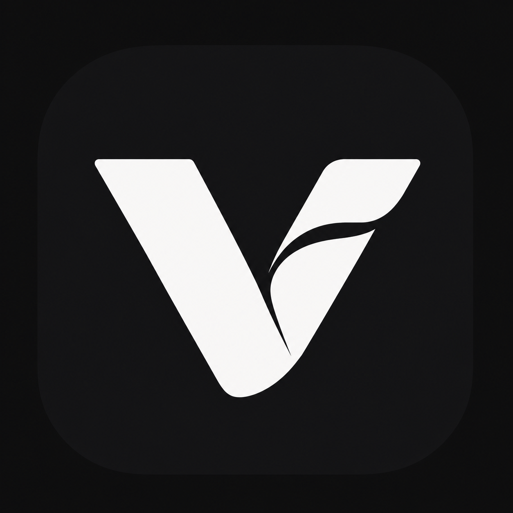
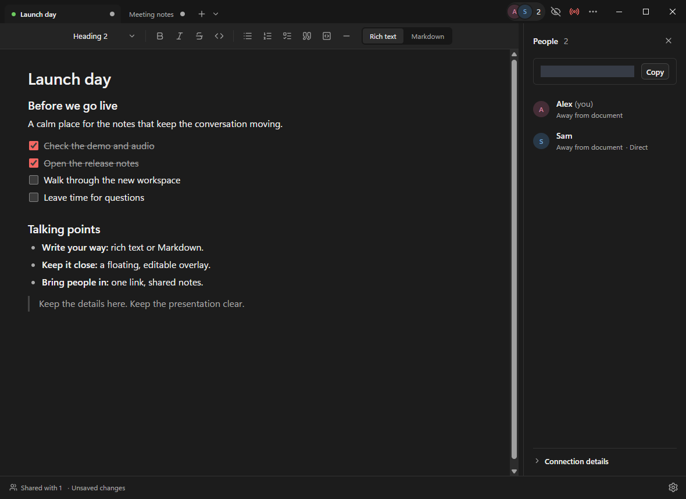
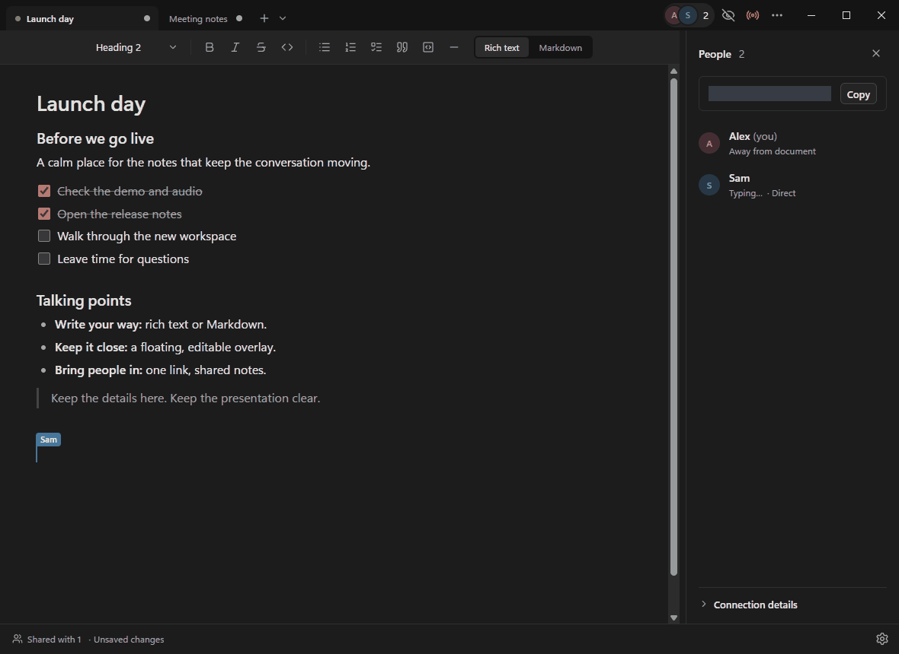
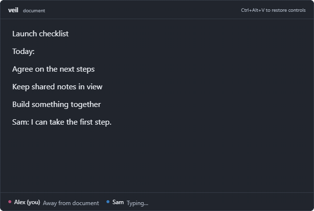
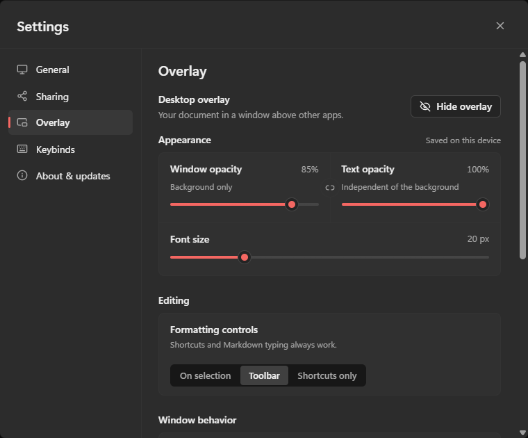
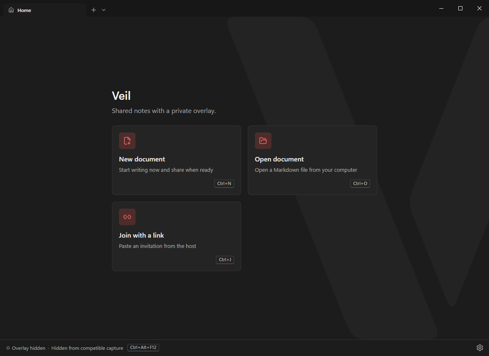

<div align="center">



# Veil

**Your words. A shared space. Always in view.**

Real-time collaborative notes with a customizable desktop overlay for Windows.

[**Download for Windows**](https://github.com/ahmad-fatayerji/veil/releases/latest) · [Getting started](#get-started) · [Self-hosting](https://github.com/ahmad-fatayerji/veil-server) · [Report an issue](https://github.com/ahmad-fatayerji/veil/issues)

[](https://github.com/ahmad-fatayerji/veil/releases/latest) [](LICENSE) [](https://github.com/ahmad-fatayerji/veil/releases/latest)



</div>

Veil gives you a temporary space to write together and a floating overlay to keep those notes beside whatever you're doing. Use it for meeting notes, a shared checklist, or a quick brainstorming session. Start writing locally, then invite people when you're ready.

## See it in action

### Write together

Create a document, share a session link, and edit together in real time. The People panel shows who's there and their activity; named cursors and selections keep everyone's work easy to follow.



### Keep your notes close

The overlay shows the same live document in a separate window. Move it, resize it, choose your font size and opacity, and keep it on top of other apps. Turn on click-through when you want to interact with the window underneath.



[View the overlay screenshot](docs/media/overlay.png).

<details>
<summary>See the overlay controls</summary>



</details>

| Make it yours           | What you can do                                                                                           |
| ----------------------- | --------------------------------------------------------------------------------------------------------- |
| A document in seconds   | Write locally without setting up a server.                                                                |
| A shared space          | Invite multiple participants with a reusable session link. There is no application-level participant cap. |
| Notes that stay visible | Edit from the control panel or the movable, resizable overlay.                                            |
| Your preferred look     | Choose light, dark, or system theme and save your overlay preferences on this device.                     |
| Connections you control | Self-host the sharing server; peer connections use a direct path when available and TURN when needed.     |
| Updates in the app      | Check for signed updates in Settings and choose the stable or beta channel.                               |

## Get started

1. [Download the latest Windows installer](https://github.com/ahmad-fatayerji/veil/releases/latest) and run the setup `.exe`. Veil supports Windows 10 and 11 on x64; the installer installs WebView2 if needed.
2. Open Veil, enter an optional name, and choose **Create document**. You can start writing immediately.
3. Choose **Show overlay** to keep your document in view. Customize it under **Settings → Overlay**.



### Invite your people

The host needs a [self-hosted Veil server](https://github.com/ahmad-fatayerji/veil-server) with HTTPS and an operator-issued host credential. Configure it under **Settings → Hosting server**, then choose **Share → Copy link** and send the link to your guests.

Guests install Veil, open the link (or paste it into **Join session**), enter a name, and join. They don't need to configure a server. Keep the host app open for the session to continue.

### A few things to know

- **Documents are temporary.** Copy anything you want to keep before closing a document, leaving a session, or quitting Veil.
- Closing the main window moves Veil to the tray by default. Use **Quit Veil** in the tray menu to exit, or change the close behavior in Settings.
- **Ctrl+Alt+V** restores interaction and brings back the control panel. **Ctrl+Alt+Shift+V** hides or shows the overlay.
- Overlay capture exclusion works only with compatible capture methods. Test your recording or screen-sharing setup first; the control panel remains capturable. See [capture compatibility](docs/capture-compatibility.md).
- Update packages are signed for Veil's updater. Windows SmartScreen may still show a warning because the installer does not currently have an Authenticode signature.

## Build and contribute

Veil is open source: this repository contains the desktop app, shared editor packages, installers, and release automation. Contributions start from `develop`; `main` contains approved release source.

For local Windows development, install Node.js 22.12+, pnpm 10.30.1, Rust, the Visual Studio C++ build tools, and WebView2. Then:

```powershell
git clone https://github.com/ahmad-fatayerji/veil.git
cd veil
pnpm install --frozen-lockfile
pnpm dev:desktop
```

[Project specification](PROJECT_SPEC.md) · [Architecture](docs/architecture.md) · [Testing](docs/testing.md) · [Networking](docs/automatic-networking.md) · [Releases](docs/releasing.md) · [Contributing workflow](AGENTS.md)

Found a bug or have an idea? [Open an issue](https://github.com/ahmad-fatayerji/veil/issues) with the steps to reproduce it and your Veil version.

## Star history

<a href="https://www.star-history.com/?repos=ahmad-fatayerji%2Fveil&type=date&legend=top-left">
  <picture>
    <source media="(prefers-color-scheme: dark)" srcset="https://api.star-history.com/svg?repos=ahmad-fatayerji/veil&amp;type=Date&amp;theme=dark" />
    <source media="(prefers-color-scheme: light)" srcset="https://api.star-history.com/svg?repos=ahmad-fatayerji/veil&amp;type=Date" />
    
  </picture>
</a>

[**View Veil on Star History →**](https://www.star-history.com/?repos=ahmad-fatayerji%2Fveil&type=date&legend=top-left)

## License

[MIT](LICENSE) © Ahmad Fatayerji. Free to use, modify, and distribute, including commercially, with the copyright and license notice retained.

Made by [Ahmad Fatayerji](https://ahmadfatayerji.com).
