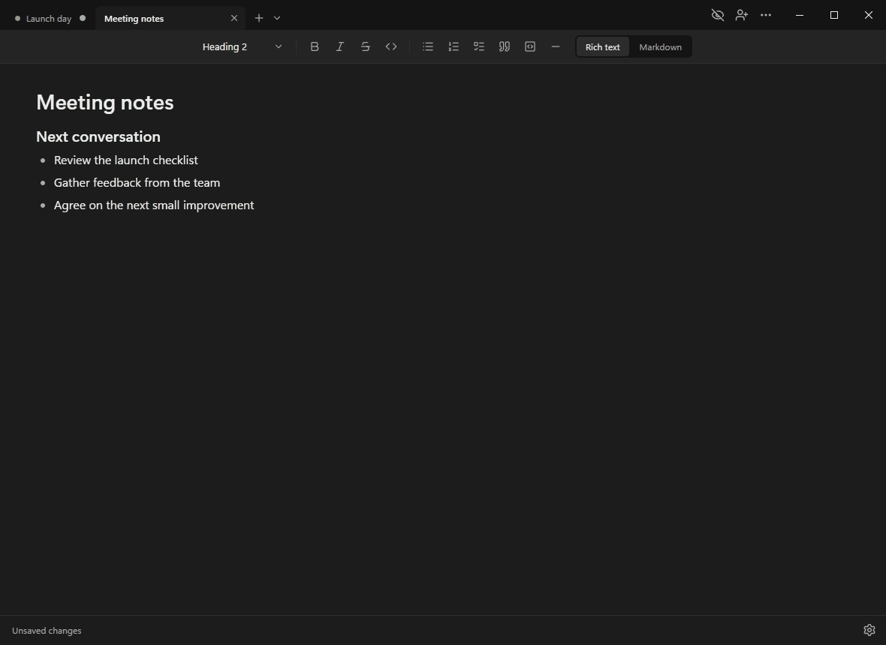



# Veil

**Your notes. Your collaborators. Your overlay.**

Collaborative Markdown notes for Windows, with an overlay that stays visible to you while compatible recordings capture what's underneath.

[**Download for Windows**](https://github.com/ahmad-fatayerji/veil/releases/latest) · [Report an issue](https://github.com/ahmad-fatayerji/veil/issues) · [Self-hosting](https://github.com/ahmad-fatayerji/veil-server)

  

## Features

- **A floating, editable overlay.** Keep notes on top, move and resize them, or let clicks pass through. Adjust font size, background opacity, and text opacity independently.
- **Capture exclusion.** Keep the overlay out of compatible recordings and screen sharing. Results depend on the capture method; the main window remains capturable. [Compatibility details](docs/capture-compatibility.md).
- **Rich text and Markdown.** Switch views while editing the same document, with headings, checklists, lists, quotes, and code.
- **Live collaboration.** Share a reusable link, see cursors and participant activity, and optionally approve new guests. Connections are encrypted.
- **Multiple documents.** Work in tabs with independent sharing sessions. Background sessions stay connected; the overlay follows your selected tab.
- **Local files and recovery.** Open and save Markdown files, keep private local copies, and optionally restore tabs and unsaved drafts. No account required.
- **Public or self-hosted sharing.** Use Veil's public servers for small sessions, or your own compatible server for more control.
- **Your desktop, your preferences.** Light and dark themes, custom accent colors, tray mode, optional Windows startup, Discord activity controls, and signed app updates.

### Write together

Sam adds a note, Alex checks a shared task and replies, and both see the changes live.

### Switch between Markdown and rich text

Write next steps in Markdown, then check them off in the formatted view.

### Keep your notes close

Change the overlay's font size and switch the document it follows.

[MIT](LICENSE) · Made by [Ahmad Fatayerji](https://ahmadfatayerji.com).
